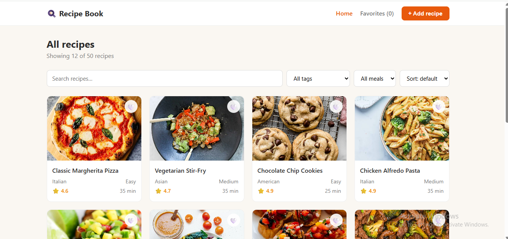

# Recipe Book

single page Recipe Book website that pulls recipes from the dummyjson API and lets you search, 
filter by tag/meal, sort, paginate, favourite, and open full recipe details — plus add your own.

## Screenshots

## How to run

1. Clone the repository.
2. Open `index.html` with Live Server.

## Features

- Recipe grid loaded from the dummyjson API, 12 recipes per page, with pagination.
- Search recipes by name.
- Filter by meal type (breakfast / lunch / dinner / snack) and by tag.
- Sort by name (A–Z), best rating, or fastest cook time.
- Favourite recipes with a heart; saved in `localStorage` so they survive a reload. The header shows the count and a Favorites view lists them.
- Recipe detail modal with ingredients, instructions, times, servings and calories.
- "Add recipe" form with client-side validation (all fields required, name at least 3 characters). The submit button is disabled while the request runs, the recipe is POSTed to the API, and the server's id is shown back.
- Loading, empty and error states for the grid.

## API

| Request | Used for |
|---|---|
| `GET https://dummyjson.com/recipes?limit=12&skip=0` | The list on the home page |
| `GET https://dummyjson.com/recipes/search?q=…` | Search by name |
| `GET https://dummyjson.com/recipes/meal-type/{type}` | Filter by meal type |
| `GET https://dummyjson.com/recipes/tag/{tag}` | Filter by tag |
| `GET https://dummyjson.com/recipes/tags` | Fill the tag dropdown |
| `GET https://dummyjson.com/recipes/{id}` | Recipe detail modal and the favorites list |
| `POST https://dummyjson.com/recipes/add` | Submit the "Add recipe" form |

## Bonus tasks

no bonus tasks were made.

## What I would improve

I would add buttons for last and start page. Also manual saved recipes dont save in recipe list.

## AI use

I used AI-commandcode as my tutor and guide mentor. It helped me with everything i build from scratch. gave me advices, checked the errors and bugs, helped me to build website step by step.
